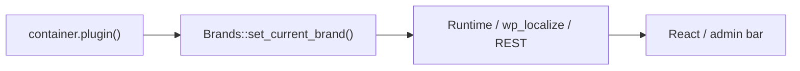

# Brand-agnostic implementation plan (onboarding + editor-chat)

This document describes the cross-module initiative to make **wp-module-onboarding** and **wp-module-editor-chat** work for any Newfold host-brand plugin, not only Bluehost.

**Terminology:** *Brand-agnostic* means **multi-brand** (Bluehost, HostGator, Web.com, Crazy Domains, etc.), not “git branch.”

**Onboarding eligibility (option A):** Enable the onboarding module for every brand slug defined in `Brands::get_brands()`, with the active brand resolved from the **module loader container** (same approach as `wp-module-help-center`).

## Git workflow

| Repo | Branch |
|------|--------|
| wp-module-onboarding | `feature/brand-agnostic-onboarding` |
| wp-module-editor-chat | `feature/brand-agnostic-editor-chat` |

Start from up-to-date `main`, then open **one PR per repo** (e.g. title: *Make module brand-agnostic*).

## Reference patterns (other modules)

| Module | What to reuse |
|--------|----------------|
| **help-center** | `Brands::set_current_brand( $container )` in bootstrap |
| **reset** | `BrandConfig::get_brand_id()`, `get_brand_name()` from `container()->plugin()` |
| **ai-chat** | `brand_id` for handshake/API + `mm_brand` fallback |
| **host plugin runtime** | `window.NewfoldRuntime.plugin.brand` in JS when needed |

---

## wp-module-editor-chat (this repo)

### 1. PHP brand layer

**`includes/Data/BrandConfig.php`** (reset + ai-chat patterns):

- `get_brand_id()` — `container()->plugin()->id` or `brand`, fallback `get_option( 'mm_brand', 'bluehost' )`
- `get_brand_name()` — `container()->plugin()->name`
- Portal links: defaults per known brand plugin id, overridable via **`nfd_editor_chat_brand_links`**

**`includes/ChatEditor.php`:**

- Handshake uses `BrandConfig::get_brand_id()`
- Admin bar: `sprintf( __( '%s AI Editor', 'nfd-editor-chat' ), BrandConfig::get_brand_name() )`
- `wp_localize_script`: `brand` → `{ id, name, accountUrl, emailUrl, billingUrl, adminUrl }`

### 2. React / TypeScript / SCSS

| Area | Change |
|------|--------|
| Header menu | `BrandDropdownMenu`; URLs from `window.nfdEditorChat.brand`; portal label via `sprintf` |
| `HeaderLeft.tsx` | Import `BrandDropdownMenu` |
| `SidebarHeader.jsx` | `sprintf( __( '%s AI Assistant', ... ), brandName )` |
| Icons | `BrandIcon` (neutral grid icon + brand name text) |
| Styles | `nfd-editor-chat__brand-menu` (replaces `__bluehost-menu`) |

Prefer `nfdEditorChat.brand` over ad hoc `NewfoldRuntime` for editor-specific data.

### 3. Tests and build

- **`tests/wpunit/BrandConfigWPUnitTest.php`**
- `npm run build` → update `build/<version>/`
- `composer run test` when vendor is installed

---

## wp-module-onboarding (sibling repo)

Summary for reviewers working across both PRs:

- `Brands::set_current_brand()` in bootstrap; **`BrandConfig`** replaces **`Bluehost`**
- Module active for all keys in **`Brands::get_brands()`**
- SPA **`BrandLogo`** uses `runtime.currentBrand`

See wp-module-onboarding `docs/brand-agnostic-plan.md` for full onboarding detail.

---

## Documentation and PRs

| File | Purpose |
|------|---------|
| `docs/integration.md` | Multi-brand behavior, filter hook |
| `docs/development.md` | Test on non-Bluehost brand plugins |
| `AGENTS.md` | No hardcoded “Bluehost” in UI |
| **`docs/pr-brand-agnostic.md`** | English GitHub PR body template |

## Execution order

1. Pull `main`; create feature branches on both repos.
2. Implement onboarding and editor-chat changes in parallel or sequence.
3. Build front-end assets and run PHPUnit.
4. Manual smoke on a brand plugin install (symlinked module).
5. Open PRs using `docs/pr-brand-agnostic.md`.
